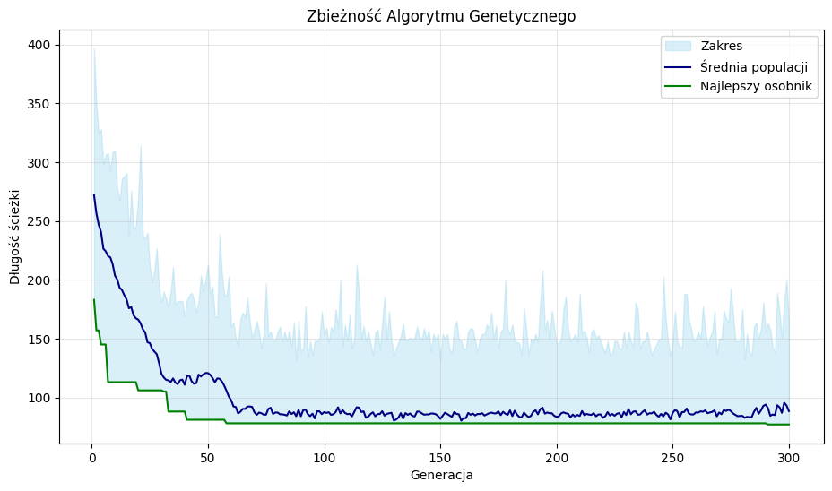
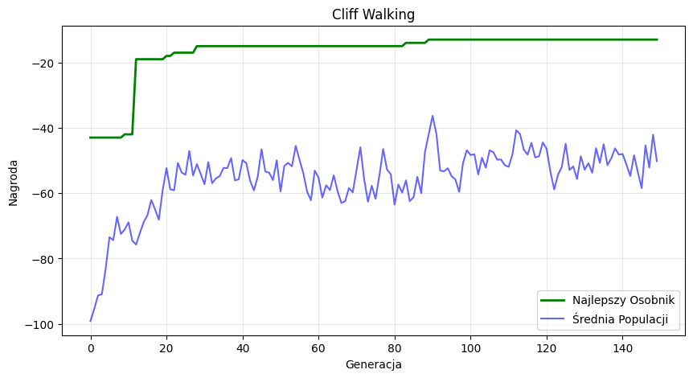

# 🧬 BIAI: Genetic Algorithms, from Scratch

**Evolution as a search engine.** Two genetic algorithms written from scratch in NumPy (no GA libraries) for the *Biologically Inspired Artificial Intelligence* course at the Silesian University of Technology:

1. **Travelling Salesman Problem:** evolve the shortest round trip through 20 cities.
2. **Cliff Walking:** evolve a sequence of moves for the Gymnasium grid world. No reinforcement learning is involved, only selection pressure.


## 1 · Travelling Salesman (`code/tsp.ipynb`)

| Component | Choice |
|---|---|
| Genome | permutation of cities 1…N−1. City 0 is the fixed start and end |
| Fitness | total route length over a random **asymmetric** distance matrix (cost 1–29) |
| Selection | tournament (roulette wheel also implemented) |
| Crossover | **OX1** order crossover, p = 0.8 |
| Mutation | swap two cities, p = 0.15 |
| Elitism | the best individual always survives |
| Setup | 20 cities · 100 individuals · 300 generations · seed 123 |

**Result:** the best route drops from ~183 to **77**, about 58% shorter than the best random route at the start. The population mean settles near the elite after roughly 60 generations.

<p align="center"></p>

## 2 · Cliff Walking (`code/cw.ipynb`)

The agent has to cross a 4×12 grid without stepping off the cliff. Each step costs −1 and a fall costs −100.

| Component | Choice |
|---|---|
| Genome | 50 actions (↑ → ↓ ←) |
| Fitness | episode reward; a fall ends the episode |
| Selection | tournament, k = 3 |
| Crossover | single-point, p = 0.6 |
| Mutation | per-gene random action, p = 0.05 |
| Setup | 100 individuals · 150 generations · seed 42 |

**Result:** the best plan improves from −43 to **−13**, the optimal 13-step path that runs right along the cliff edge.

<p align="center"></p>

## Run it

```bash
pip install numpy matplotlib seaborn gymnasium jupyter
jupyter notebook code/
```

Notebook comments and plot labels are in Polish.

